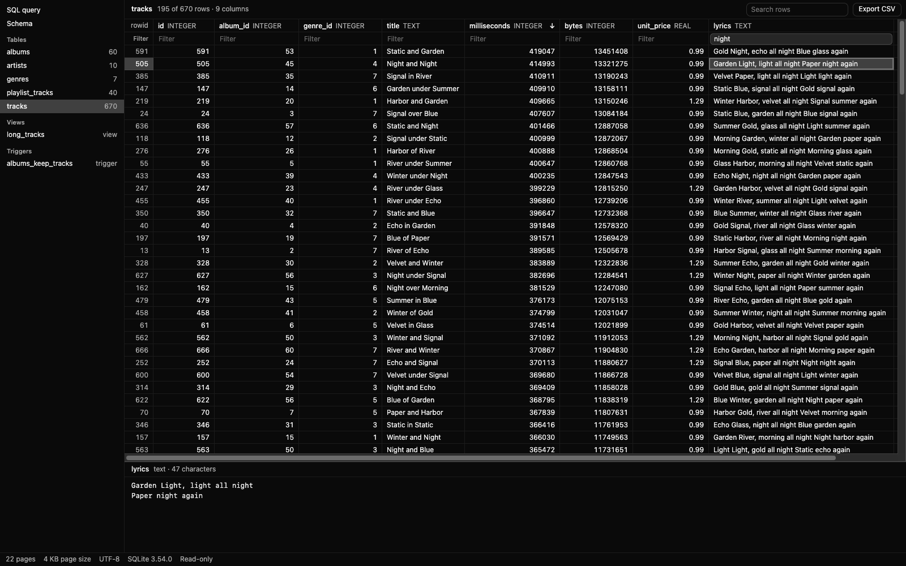
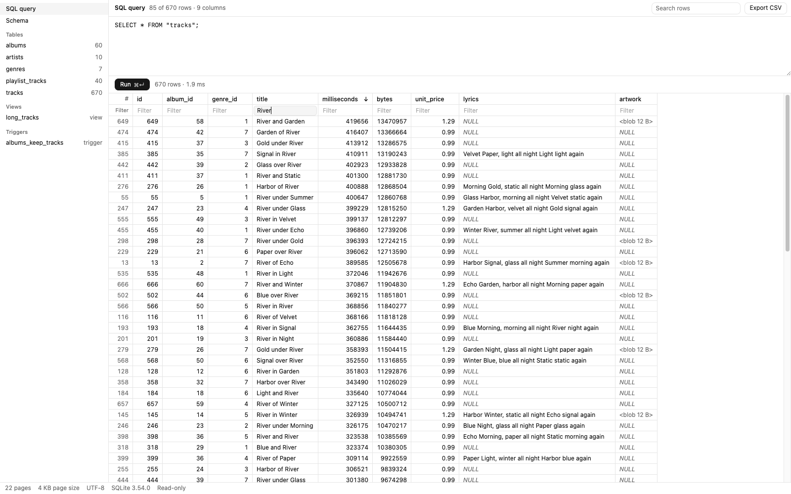

# SQLite Browser for Orca

Open SQLite databases in an Orca editor tab. Browse every table and view, run SQL queries, filter
and sort by column, copy cells and rows, and export rows as CSV, without leaving Orca. It only
reads: nothing in the database changes. Requires Orca 1.4.248 or later in the desktop app;
elsewhere Orca opens the file in Source.

## Use it

After installing it from **Settings → Plugins**, open any `.db`, `.sqlite`, `.sqlite3` or `.db3` file
from the file explorer. To see the raw file instead, switch the tab to **Source**.

- **Tables and views:** pick one on the left to see its rows. The grid only draws the rows on
  screen, so tables with millions of rows scroll smoothly.
- **SQL query:** pick **SQL query**, type a query and press ⌘↵ (Ctrl+Enter on Windows and Linux),
  or select part of the text to run only that. A script runs statement by statement and shows the
  rows of the last one that returns any. Cancel stops a long query.
- **Sort and filter:** click a column name to sort by it (again for descending, a third time to
  stop). Type in the box under a column name to keep rows whose value contains that text, or use
  `=x`, `!=x`, `>x`, `>=x`, `<x`, `<=x`, `null` or `!null`. **Search rows** keeps rows where any
  column contains the text. Query results sort and filter the same way.
- **Copy:** click a cell, drag or Shift-click to select more, or click row numbers to select whole
  rows. ⌘C (Ctrl+C) copies the selection as tab-separated text that pastes into a spreadsheet;
  right-click for **Copy with column names** and **Copy rows**.
- **Export CSV:** saves the rows on screen, with the current filters and sort, through Orca's save
  dialog (up to 64 MB).
- **Cell values:** select a cell to see its full value below the grid. Long text wraps and binary
  values show as hex.
- **Schema:** see the `CREATE` statement of every table, view, index and trigger.

The browser follows your Orca theme and reloads when the file changes on disk.

## Good to know

- **Read-only.** Queries run on a copy of the file in memory with writes switched off, so
  `INSERT`, `UPDATE`, `DELETE` and `CREATE` fail with a message. To change data, use the `sqlite3`
  command line or your app. Editing cells is not offered: Orca saves an editor's file by replacing
  it whole, and an app that has the database open (or changes still in its `-wal` or `-journal`
  file) would then lose writes or corrupt it, which this editor cannot detect.
- **Files up to 64 MB.** That is the most Orca hands to a plugin editor.
- **Recent writes may be missing.** In a database that uses write-ahead logging, the newest changes
  can sit in a separate `-wal` file that this browser doesn't read; it shows a notice when that may
  be the case.
- **No network.** The browser runs in Orca's isolated frame for plugin editors, with no network
  access, and reads the file with SQLite compiled to WebAssembly. Encrypted databases can't be
  opened.

## What is in this folder

- `orca-plugin.json`: what Orca loads. The editor runs only in Orca's isolated editor frame
  (`"frame": "isolated"`), which can run WebAssembly and workers.
- `editor/`: the built editor that Orca loads, `index.html` plus its code, its database worker and
  SQLite in `assets/`. Generated and committed: never edit it by hand.
- `build/`: the source of `editor/`, the build recipe and the tests. See
  [build/README.md](build/README.md).
- `images/`: the catalog cover and screenshots.

## Changelog

### 2.0.0

- SQL query console, with results in the same grid.
- Sort by any column, filter each column, and search all of them, in tables, views and query
  results.
- Select ranges of cells or rows; copy as tab-separated text, with or without column names.
- Export rows as CSV through Orca's save dialog.
- Views show their rows, and generated columns their values: the file is now read by SQLite
  itself (compiled to WebAssembly), in a worker so a long query never freezes the tab.
- Built from source in `build/`, with tests, on Orca's document session. Needs Orca 1.4.248 and
  the desktop app; older Orca keeps 1.0.0.

### 1.0.0

Read-only browser for tables, views and schema, with its own SQLite file reader.

## License

MIT. See [LICENSE](LICENSE). The bundled software is listed in
[THIRD_PARTY_NOTICES.txt](THIRD_PARTY_NOTICES.txt).
